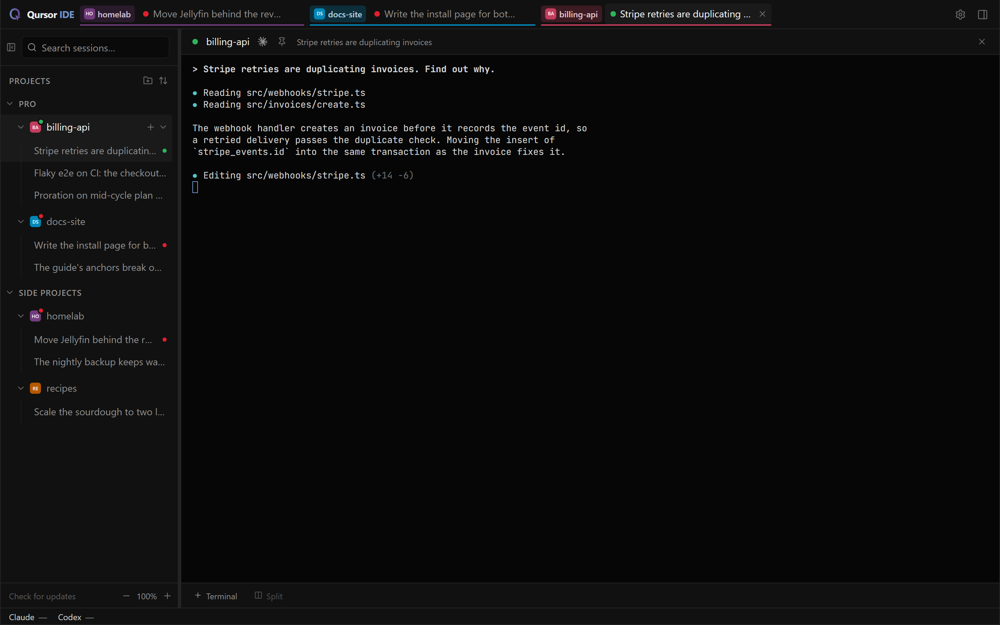
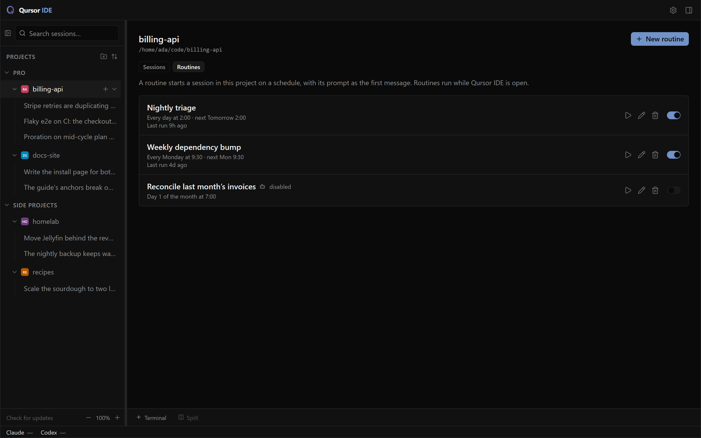
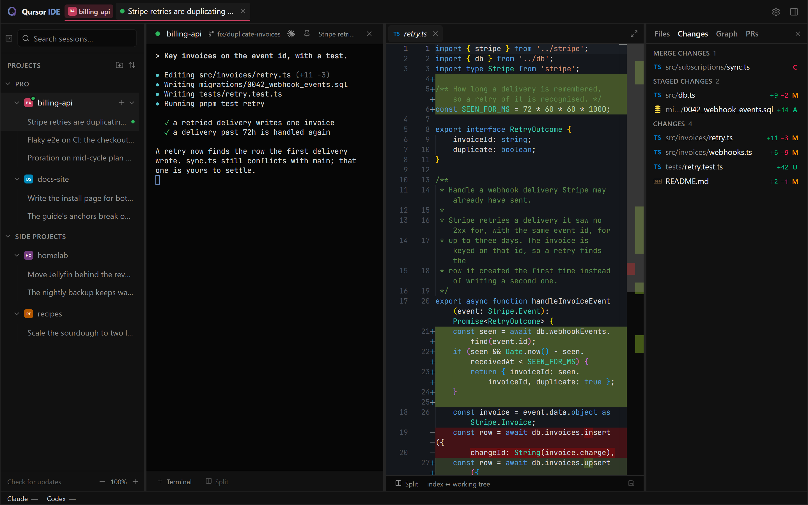
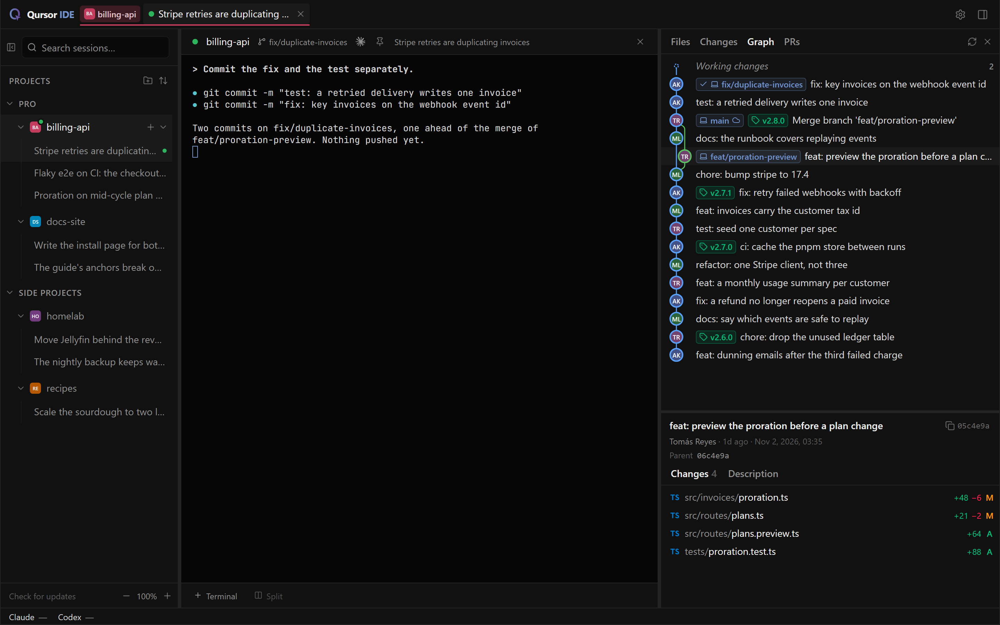
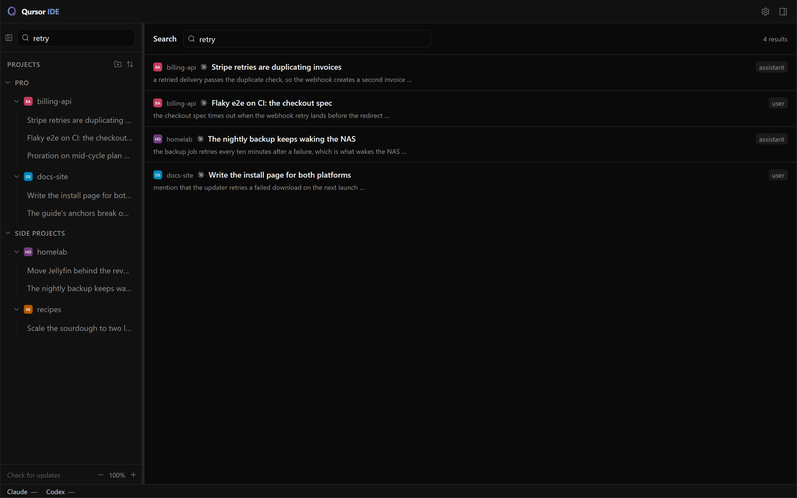
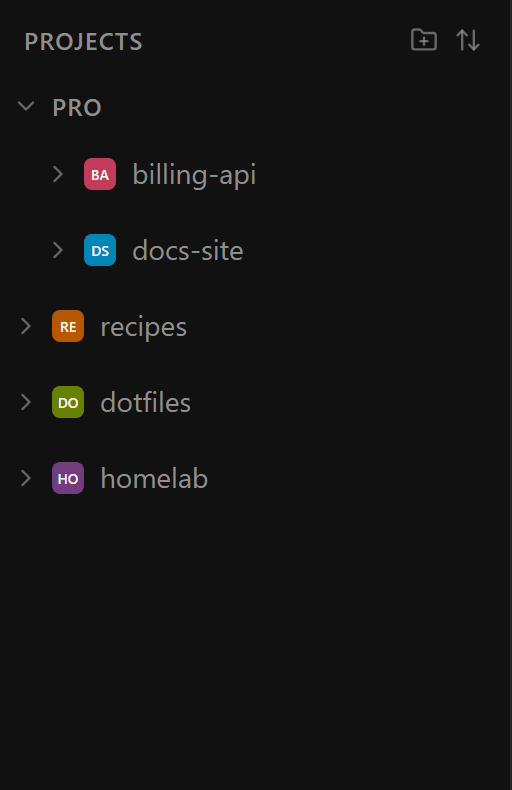

<div align="center">

<picture>
  <source media="(prefers-color-scheme: dark)" srcset="apps/desktop/public/qursor-lockup-dark.png">
  
</picture>

# Qursor IDE

### IDE is dead. Long live the ADE.

**The Agentic Development Environment for Claude Code and Codex, with native Windows support.**

[](https://github.com/qursor-it/qursor-ide/releases/latest)
[](#-windows-first)
[](#build-from-source)
[](LICENSE)
[](#status)

[**Download for Windows**](https://github.com/qursor-it/qursor-ide/releases/latest) ·
[Features](#-features) ·
[Install](#-install) ·
[Contributing](CONTRIBUTING.md) ·
[Security](SECURITY.md)

</div>

---

You stopped writing most of the code. Your editor never noticed.

Qursor IDE is built the other way round: **the unit of work is a session, not a
file.** You supervise, decide, review and set the rules. Agents do the rest.
Free, open source, local-first: no account, no telemetry, no paid tier.

> [!NOTE]
> Qursor IDE is a fork of [**factorai**](https://github.com/Nightbr/factorai) by
> Titouan BENOIT and contributors, released under the MIT licence. It adds a
> native Windows build, its own signed update feed, a usage monitor and more.
> It is not the official factorai project: report problems with Qursor IDE
> [here](https://github.com/qursor-it/qursor-ide/issues), not upstream.

## Contents

- [Windows first](#-windows-first)
- [Features](#-features)
- [Install](#-install)
- [Build from source](#build-from-source)
- [Status](#status)
- [Contributing](#-contributing)
- [Credits and licence](#-credits-and-licence)

## 🪟 Windows first

Most agent tools treat Windows as an afterthought, or send you to WSL.
**Qursor IDE runs natively on Windows.**

| | |
|---|---|
| **No WSL needed** | A native x64 app built on Tauri and WebView2, with a one-click NSIS installer. |
| **Real Windows terminals** | Agents and shells run on Windows' own ConPTY, with PowerShell, not inside a Linux VM. |
| **Taskbar usage widget** | Your Claude and Codex plan limits and reset countdowns, right in the Windows taskbar (tray icon as a fallback). |
| **Signed auto-updates** | The app checks this repository's releases, verifies the signature and asks before restarting. |
| **Windows conventions** | `Ctrl+C` copies a terminal selection, `Ctrl+Shift+C` too; Windows paths and drive letters open as links. |

## ✨ Features

### Run several agents at once

Each session is the real `claude` or `codex` CLI in a real terminal, and keeps
running when you look away. A dot says whether it is *working*, *waiting for
you* or *stopped*, and a desktop notification tells you when a background
session needs you.



### Know what you are spending

A status bar shows your plan limits, when they reset and what each session has
cost so far, for Claude and Codex alike.

### Agents on a schedule

A routine is a saved prompt on a cron, per project. It runs in the background
without taking a tab, and catches up on runs missed while Qursor IDE was closed.



### Review like a maintainer

Changes, diffs and the commit graph sit beside the terminal and keep up with an
agent mid-edit. Open a GitHub pull request as a tab, check it out into a new
worktree, comment on its diff and submit the review without leaving the app.





### Every message, every session

Full-text search across every transcript, read in place from `~/.claude` and
`~/.codex`. Nothing imported, nothing copied.



### Arranged the way you think

Drag projects into groups you name, or sort by name or recent. Keyboard too.



### Local and private

No telemetry, no account, no server. Qursor IDE drives the CLIs you already
logged into and never touches your credentials. Closing the window stops every
agent it started.

## 📦 Install

### Windows

1. Download `qursor-ide_<version>_x64-setup.exe` from the
   [latest release](https://github.com/qursor-it/qursor-ide/releases/latest).
2. Run it. The installer fetches WebView2 if your system lacks it.
3. Install and sign in to [Claude Code](https://claude.com/claude-code) or
   [Codex](https://developers.openai.com/codex/cli). Git is needed for
   worktrees.

**Requirements:** Windows 10 version 1809 or later, or Windows 11, on x64.
ARM64 is not supported yet. More detail in
[docs/windows-native.md](docs/windows-native.md).

### macOS and Linux

There are no prebuilt Qursor IDE packages for macOS or Linux:
[build from source](#build-from-source). A source build has no auto-updater, so
pull and rebuild to update. Prebuilt macOS and Linux apps are available from
upstream [factorai](https://github.com/Nightbr/factorai/releases).

## Build from source

You need Node.js 24, pnpm 10 and Rust stable, plus
[Tauri's prerequisites](https://v2.tauri.app/start/prerequisites/) for your
platform.

```bash
git clone https://github.com/qursor-it/qursor-ide.git
cd qursor-ide
pnpm install
pnpm dev                # run the app in development (on Windows: pnpm dev:windows)
```

| Platform | Build command | Output |
|---|---|---|
| Windows | `pnpm build:windows` | `target/release/bundle/nsis/*-setup.exe` |
| macOS / Linux | `pnpm --filter @factorai/desktop build` | `target/release/bundle/` |

[CONTRIBUTING.md](CONTRIBUTING.md) has the full setup, the checks a change must
pass and how to run the tests.

## Status

Qursor IDE is **alpha**: used every day, still changing fast. Point it at work
your version control can recover. Releases are published from tags on this
repository and listed in [Releases](https://github.com/qursor-it/qursor-ide/releases).

## 🤝 Contributing

Issues, ideas and pull requests are welcome.

- **Bugs and feature requests:** [open an issue](https://github.com/qursor-it/qursor-ide/issues).
- **Questions and ideas:** [Discussions](https://github.com/qursor-it/qursor-ide/discussions).
- **Code:** read [CONTRIBUTING.md](CONTRIBUTING.md) first. Small, focused PRs get merged fastest.
- **Security problems:** report them privately, as [SECURITY.md](SECURITY.md) explains.

## 📜 Credits and licence

Qursor IDE stands on [**factorai**](https://github.com/Nightbr/factorai), created
by Titouan BENOIT and its contributors. Thank you for building it in the open.

Released under the [MIT licence](LICENSE).
© 2026 Titouan BENOIT and contributors, © 2026 Qursor.

<div align="center">
<sub>If Qursor IDE saves you time, a ⭐ on GitHub helps others find it.</sub>
</div>
